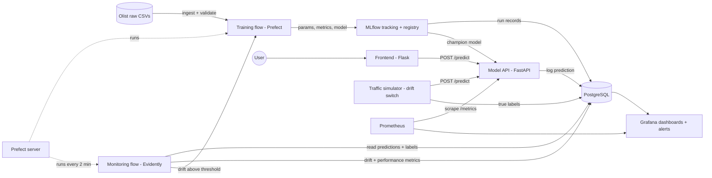
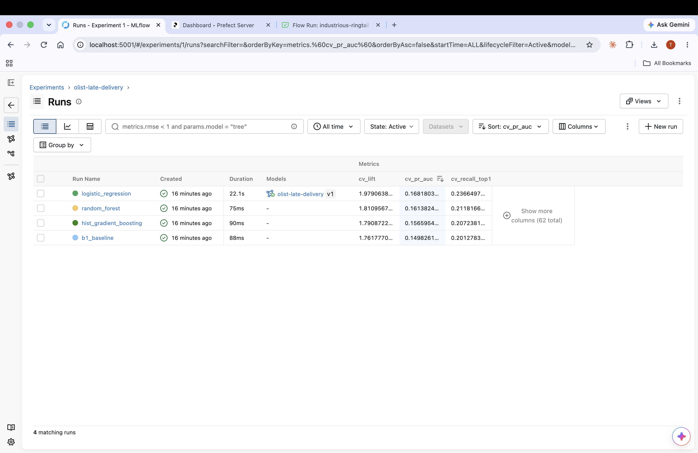
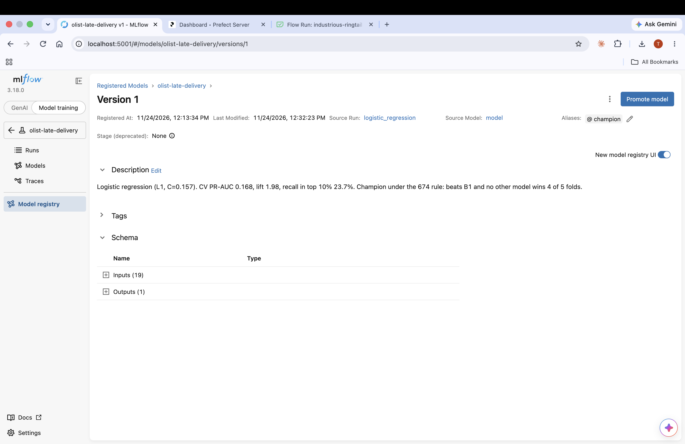
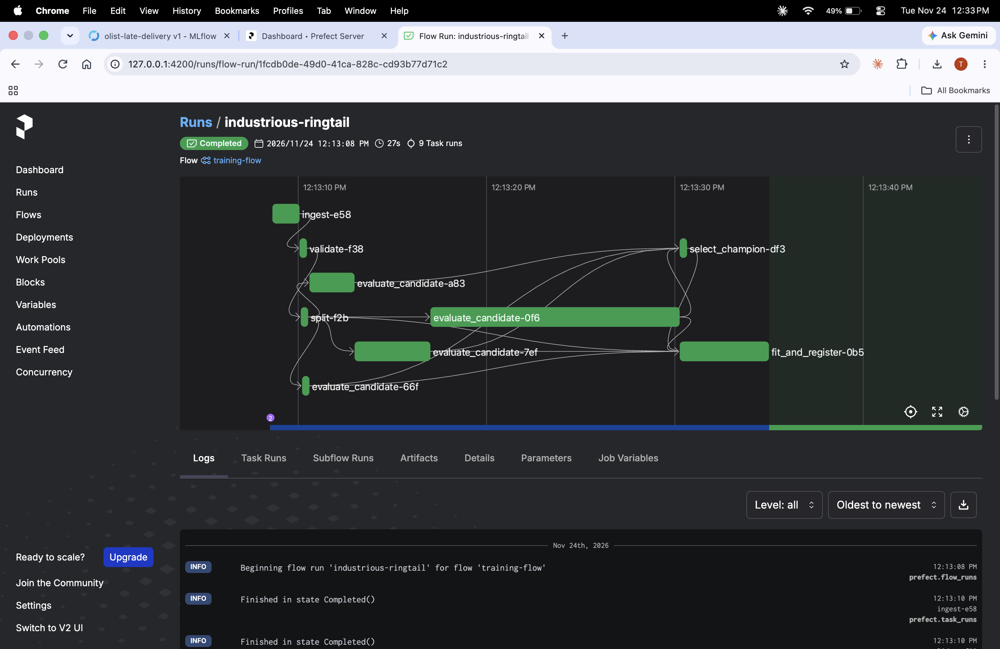

# Olist late-delivery risk: an end-to-end MLOps system

INSY 684, McGill MMA, Fall 2026. This project takes our INSY 674 model, which flags Olist orders likely to arrive late at the moment they are approved, and runs it as a production system on a laptop: an orchestrated training pipeline, experiment tracking and a model registry, a model API with a web frontend, and monitoring that detects drift and triggers retraining. One `docker compose up` starts everything.

| Member | GitHub | Owns |
| --- | --- | --- |
| Jay Malhotra | [@JustJay7](https://github.com/JustJay7) | Platform, CI/CD, integration |
| Mia Scalabrin | [@MiaMakarov](https://github.com/MiaMakarov) | Data ingestion and features |
| Tasnim Hassan | [@tasnimrh](https://github.com/tasnimrh) | Training flow and MLflow |
| Fidan Shiraliyeva | [@shiraliyeva](https://github.com/shiraliyeva) | Model API and Prometheus |
| Peace Isaac | [@LoluPH](https://github.com/LoluPH) | Frontend and Grafana |
| Hasan Malik | [@Hasan8036](https://github.com/Hasan8036) | Traffic simulator and drift |
| Jingyu Wu | [@Jing-yu-Wu](https://github.com/Jing-yu-Wu) | Monitoring and retraining trigger |

## 1. Problem

> TODO (Hasan): the problem from our 674 framing: who uses the model, what it predicts, why accuracy is the wrong metric, and what the ops team does with the top 10%.

## 2. Architecture



A user's order goes from the frontend to the model API. The simulator posts unseen orders to the same endpoint and writes their true labels to Postgres. The API logs every prediction, the monitoring flow measures drift and performance from those logs, and when drift crosses the threshold it starts the training flow again.

## 3. Run it locally

Needs Docker Desktop (no Docker account required) and Git.

```bash
git clone https://github.com/JustJay7/olist-late-delivery-mlops.git
cd olist-late-delivery-mlops
cp .env.example .env
docker compose up --build
```

On the first start the pipeline trains and registers a model before the API can answer, which takes a few minutes. Then:

| What | Where |
| --- | --- |
| Frontend | http://localhost:8080 |
| Model API docs | http://localhost:8000/docs |
| MLflow | http://localhost:5001 |
| Prefect | http://localhost:4200 |
| Grafana | http://localhost:3000 |
| Prometheus | http://localhost:9090 |

Send traffic, then switch on drift:

```bash
docker compose run --rm simulator
docker compose run --rm simulator --drift
```

Stop everything with `docker compose down`, or `docker compose down -v` to also delete the stored data and models.

## 4. Tools

| Tool | What it does here |
| --- | --- |
| docker compose | Starts and stops all 9 services with one command |
| Prefect | Runs training and monitoring as flows, on a schedule or on demand |
| MLflow | Tracks every training run and holds the registered `champion` model |
| FastAPI | Serves the champion model at `/predict`, in its own container |
| Flask | The web form users fill in, in its own container, calling the API |
| Simulator (Python script) | Replays unseen 2018 orders as live traffic, with a switch that injects drift |
| Evidently | Measures data drift and model performance from logged predictions |
| PostgreSQL | Stores predictions, true labels, Evidently metrics and MLflow's run records |
| Prometheus | Collects the API's request count, latency and errors from `/metrics` |
| Grafana | Dashboards and alerts over Prometheus and Postgres, saved as code |
| GitHub Actions | CI runs lint and tests on every push and PR; CD publishes the images to GitHub Container Registry on merge |

## 5. Data

> TODO (Mia): source, population funnel (99,441 to 85,371 orders), censoring rule, time split, serving baseline vs replayed orders.

## 6. Training and experiment tracking

`flows/training_flow.py` turns the INSY 674 notebooks into one Prefect flow. Each step is a Prefect task, so every run is recorded in the Prefect UI and a failed step stops the flow in a visible place.

1. **Ingest:** `build_orders()` builds the 85,371-order table from the committed raw Olist tables.
2. **Validate:** every model input is checked against `schema.py` (columns, ranges, allowed states). Bad data stops the flow before any training.
3. **Split:** orders bought before 1 Apr 2018 are the training set. Later orders are kept as serving traffic and are never trained on.
4. **Evaluate:** the 4 candidates from 674 are scored with the same 5-fold time-series CV. Each one is logged as its own MLflow run with its parameters and the mean and standard deviation of `cv_pr_auc`, `cv_lift` and `cv_recall_top10`.
5. **Select:** the 674 champion rule. Every model must beat the B1 baseline, and a more complex model replaces logistic regression only if it is better on at least 4 of the 5 folds and its mean gain is larger than one standard error.
6. **Register:** the winner is refit without the last 2,000 training orders (their outcomes were not yet known on 1 Apr), logged with its `flag_threshold` (the score above which an order is in the riskiest 10%), registered as `olist-late-delivery` and given the alias `champion`. On a later run the alias only moves if the new model passes the same rule against the current champion.

**Results** (5-fold time-series CV, mean over folds):

| Model | PR-AUC | Lift | Recall in top 10% |
|---|---|---|---|
| Logistic regression (L1, C=0.157) | **0.168** | **1.98** | **23.7%** |
| Random forest | 0.161 | 1.81 | 21.2% |
| HistGradientBoosting | 0.157 | 1.79 | 20.7% |
| B1 baseline (promised days and state) | 0.150 | 1.76 | 20.1% |

Logistic regression is the champion. Both tree models beat it on only 1 of the 5 folds, so the rule keeps the simpler and more stable model. The numbers match INSY 674 exactly, which confirms that moving the notebooks into a pipeline changed nothing.

To run it: start MLflow and Prefect (section 3), then `python flows/training_flow.py`.







> Next in this section: the 30-trial Hyperopt sweep, recall in the top 10% for each Brazilian region (fairness) and the permutation importance plot.

## 7. Model API

> TODO (Fidan): endpoints, an example request and response, input validation, how the champion is reloaded.

## 8. Frontend

> TODO (Peace): what the form asks for, a screenshot of a prediction and of a validation error.

## 9. Monitoring and drift

> TODO (Jingyu): training-serving skew vs drift, Evidently's tests at our window size, the measured drift shares and the threshold.
>
> TODO (Hasan): the drift scenario and how to reproduce it.
>
> TODO (Peace): dashboard screenshots under normal traffic and after drift, the alert firing, and the retrain run in Prefect.

## 10. CI/CD

> TODO (Jay): the CI and CD workflows, branch rules, and where the images are published.

## 11. Tests

> TODO (everyone): one line per test file: what it checks and why it matters.

## 12. How we worked

One feature branch per change, named `feature/your-task` (or `fix/`, `test/`, `docs/`). Every change goes through a pull request that a teammate reviews with real comments, CI must pass before merging, and merges use merge commits, never squash. Secrets live only in `.env` locally and in GitHub Actions secrets.
